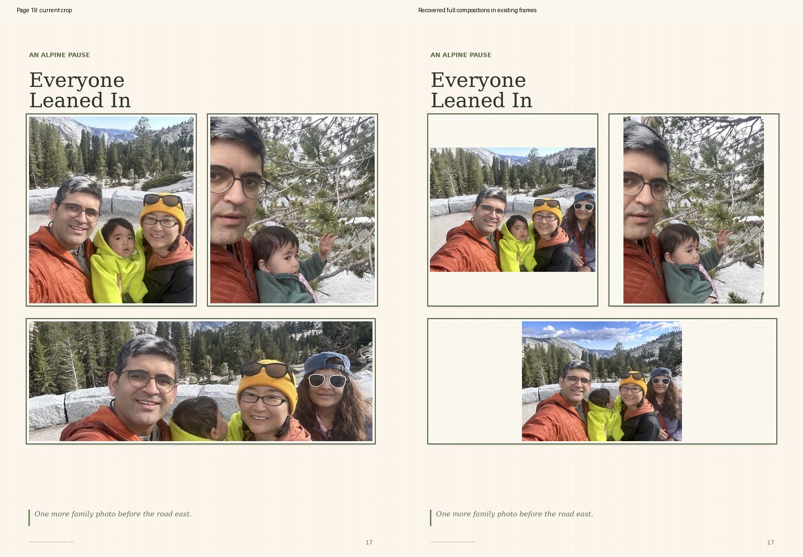
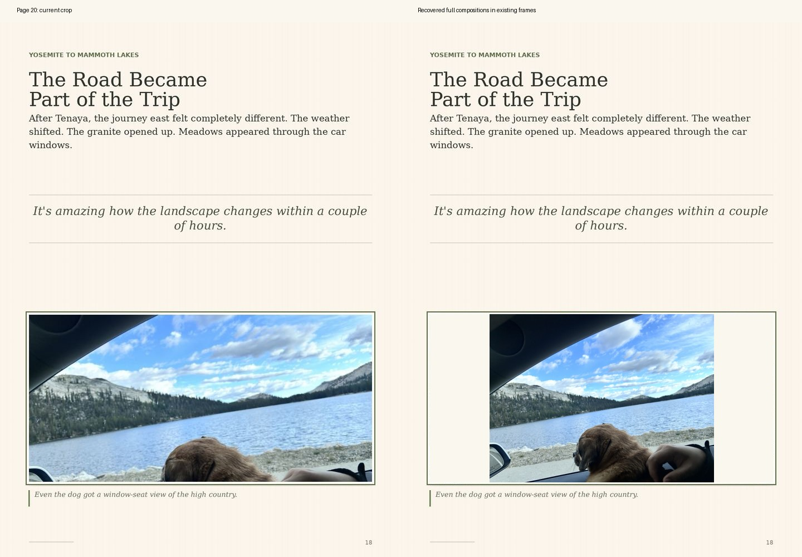

# Photograph recovery audit - 24 October 2026

The four original uploads used on web pages 19 and 20 were recovered. No photograph was invented, generated, or substituted. This change fits recovered originals inside the existing photo frames using `object-fit: contain`; the original sheets, page order, typography, captions, frame borders, and later trips remain intact. Blank matting is the necessary result when a photograph and its existing frame have different aspect ratios.

## Primary recovery

Web page numbers include the two opening pages. Printed Sierra folios on these pages are 17 and 18.

| Web page / position | Exact recovered upload | Dimensions | What the cropped version lost |
| --- | --- | --- | --- |
| 19, upper left | `16D631A6-DB3C-448D-BA53-4CAC20E79DFD.jpeg` | 1536 x 1152 | Right side, including grandmother, and surrounding scene |
| 19, upper right | `F3FE9603-092C-494E-9A30-B58B246B85FF.jpeg` | 1152 x 1536 | Top/bottom of portrait composition |
| 19, lower | `542177D8-78D1-472E-8B6F-96D00DFFFD93.jpeg` | 1536 x 1152 | Large portions above and below the panoramic crop |
| 20 | `34390921-7C3C-4CB0-8EF9-95232F4FD9E9.jpeg` | 1536 x 1152 | Mandy's face, window edge, hand, and lower foreground |

## Archived editions and other assets

- `The_Kohli_Family_Journal_Travel_Journal_v8 (1).html`: 38 embedded JPEG page images, each 900 x 1200. Its pages 17/18 correspond to current web pages 19/20 and contain the same crops. There are no embedded individual source photographs.
- `The_Zhang-Kohli_Family_Complete_Travel_Book_2026_with_Music (1).html`: 82 embedded JPEG page images, each 900 x 1200; again flattened pages with the same crops. A comparison of all 82 pages against the current sheets gave a mean absolute channel difference of 2.10/255 after downsampling, consistent with recompression/resizing rather than newly recoverable compositions.
- Repository history across all fetched branches contains no separate Sierra source photographs. The additional historic HTML viewer and sprite versions do not provide originals. `pages_10.jpg` and `pages_11.jpg` are not used by the current viewer and are not decodable JPEGs.
- The saved 82-page complete PDF and 38-page v8 PDF contain whole-page raster images (1440 x 1920). The complete package ZIP contains only that PDF and its flattened HTML edition.
- The saved September 98-page PDF labeled `Polarsteps_Inspired_No_Maps_Uncropped` contains individual photo objects, but the four relevant objects are already cropped derivatives. Its layout differs from the live book, so it was not used as a replacement.
- An earlier Word journal contains ten individual photographs, including the lower page-19 selfie; the later uploaded JPEGs provide the recovery sources used here.
- Recovery came from the user's original July uploads. `assets/recovered/manifest.json` records exact source Library IDs, SHA-256 checksums, frame coordinates, and estimated earlier visible fractions. Every committed JPEG is byte-for-byte identical to its recovered upload.

## Additional cropping

Original-image feature matching and visual comparison confirmed 33 cropped framed placements on 14 Sierra pages. All 33 are restored in this change:

| Web page | Restored framed photographs |
| --- | ---: |
| 6 | 3 |
| 8 | 3 |
| 12 | 3 |
| 13 | 1 |
| 14 | 3 |
| 16 | 2 |
| 18 | 1 |
| 19 | 3 |
| 20 | 1 |
| 21 | 3 |
| 24 | 1 |
| 25 | 3 |
| 27 | 3 |
| 30 | 3 |

The smaller crops on pages 6, 8, 16, 18 and 27 were included after the initial severe-crop pass. Existing photographs already fitted in their frames were left intact.

The full-page background designs on pages 9 (pool), 17 (Tenaya Lake), and 33 (family by the lake) also crop landscape originals to a portrait page. These are documented separately and remain unchanged because restoring their full compositions would alter the established full-page design and text/background relationship.

All 98 pages were surveyed at contact-sheet scale. Exact original-to-frame matching covered the Sierra pages (1-40); the Boston/New York and Forestville chapters were not exhaustively compared with their original uploads. This audit therefore does not certify that every photograph elsewhere is uncropped. No missing source is blocking restoration of pages 19/20.

## Verification

`node scripts/verify-photo-restoration.cjs` passes: all 98 page mappings, 33 placements, source file hashes, frame bounds, layer clearing, wraparound, and trip navigation. Reconstructed composition previews for all 14 changed pages were visually inspected. Original sprite sheets and archived HTML files are byte-for-byte unchanged.

Real Chromium browser verification passed for every page at desktop (1280 x 1024) and phone (390 x 844) viewports: 196 page renders, all source images loaded, all 33 restored placements used contain, no frame overflow, correct page statuses and zero JavaScript errors. Browser screenshots of pages 19/20 were visually inspected.
